<div align="center">

<a href="https://github.com/AdlinaAuji">
  
</a>

**CYBERSECURITY · DIGITAL FORENSICS · SOC · GRC · MACHINE LEARNING**

<br/>

<a href="https://www.linkedin.com/in/nuradlinaauji">
  
</a>
<a href="mailto:linaauji00@gmail.com">
  
</a>

</div>

---

### HEY, I'M ADLINA!

I'm a Computer Science graduate in Information Security and Assurance from USIM.

I'm interested in different areas of cybersecurity, especially digital forensics, security operations and threat investigation. During my internship at NetbyteSEC, I had the opportunity to work with SIEM tools, investigate security events, analyse forensic evidence and get some hands-on experience with malware analysis.

I also enjoyed exploring machine learning through my Final Year Project, where I developed a model to detect encrypted network traffic and classify different darknet technologies. It was interesting to see how ML algorithms could be applied to cybersecurity problems, and it got me curious to explore more in this area.

Recently, I've also started taking an interest in Governance, Risk & Compliance (GRC). I'm still learning about it, but I'm looking forward to understanding more about security governance, risk management and compliance.

Outside of studying and working on cybersecurity projects, I enjoy joining CTF competitions, exploring different tools and learning through hands-on challenges.

There's still so much to explore, and I'm enjoying the process of figuring things out along the way. :)

---

<h1 align="center">
  <strong>A LITTLE SNAPSHOT OF ME</strong>
</h1>

```javascript
const adlina = {
  background: "Information Security & Assurance",

  interests: [
    "SOC Operations",
    "Digital Forensics",
    "Threat Investigation",
    "Machine Learning in Cybersecurity",
    "Governance, Risk & Compliance"
  ],

  currentlyExploring: [
    "GRC",
    "Machine Learning"
  ],

  hobbies: [
    "CTF Challenges",
    "Security Labs"
  ],

  mindset: "Always learning, always giving"
};
```

---

<h1 align="center">
  <strong>TOOLS & TECHNOLOGIES</strong>
</h1>

**01. Security Operations & Monitoring**

<p>
  
  
  
  
</p>

**02. Digital Forensics & Incident Response**

<p>
  
  
  
  
  
</p>

**03. Network Security & Analysis**

<p>
  
  
  
  
</p>

**04. Malware Analysis**

<p>
  
  
  
  
</p>

**05. Machine Learning & Programming**

<p>
  
  
  
  
  
  
</p>

**06. Other Technologies**

<p>
  
  
  
  
  
</p>

---

<h1 align="center">
  <strong>PROJECTS & INVESTIGATIONS</strong>
</h1>

**01. Honeypot Deployment & Threat Analysis**

Deployed a Drupal honeypot environment on Ubuntu Server and worked with Splunk for log collection and threat monitoring.

- Configured over 100 simulated staff accounts.
- Integrated Sysmon for Linux and Splunk Universal Forwarder.
- Worked with the team to investigate over one million log events.
- Investigated suspicious activities involving SQL injection and database information leakage.

**02. Disk Forensics: Ransomware Investigation**

A hands-on forensic investigation involving workstation and file server disk images.

- Reconstructed the attack timeline, including initial access, payload execution and lateral movement.
- Used Autopsy, capa, dnSpy and FLARE-VM during the investigation.
- Recovered the attacker's RSA private key and decrypted affected files using OpenSSL.

**03. Malicious Network Traffic Detection at Dark Web**

My Final Year Project, where I explored how machine learning can help identify encrypted network traffic and distinguish different darknet technologies.

- Developed a two-stage detection model using flow-level network features.
- Experimented with Logistic Regression, SVM, Random Forest and CNN.
- Worked with classification of Tor, VPN, I2P, ZeroNet and Freenet traffic.
- Applied feature selection and model evaluation techniques.

---

<h1 align="center">
  <strong>EXPERIENCE</strong>
</h1>

**NetbyteSEC Sdn Bhd**

Cybersecurity Intern | February 2026 to August 2026

Worked on different cybersecurity tasks involving security monitoring, digital forensics, malware analysis and honeypot deployment.

---

<h1 align="center">
  <strong>CERTIFICATIONS & ACHIEVEMENTS</strong>
</h1>

- CompTIA Security+ | I-World Sdn Bhd, 2026
- Wireless Penetration Tester | 0day Academy, 2026
- Cloud Computing Introduction & Career in Cybersecurity | Blackberry CCoE, 2025
- 5th Innovation Bank Challenge 2025 | Silver Award

---

<h1 align="center">
  <strong>CTF & ACTIVITIES</strong>
</h1>

| Competition | Achievement |
|:---|:---:|
| LigaCTF, OWASPKL | Top 20 |
| 3108 CTF, Bahtera Siber | Top 10 |
| Hack10 CTF, UNITEN | Participant |
| Intervarsity Cyber Forensics Challenge, MCMC | Participant |
| Girl in CTF | Participant |
| AturKreatif 2026, USIM | Challenge Maker |

---

<h1 align="center">
  <strong>MY GITHUB ACTIVITY</strong>
</h1>

<p align="center">
  <i>A little game made from my GitHub contributions. ♡</i>
</p>

<picture>
  <source
    media="(prefers-color-scheme: dark)"
    srcset="https://raw.githubusercontent.com/AdlinaAuji/AdlinaAuji/output/bomberman-contribution-graph-dark.svg">
  <source
    media="(prefers-color-scheme: light)"
    srcset="https://raw.githubusercontent.com/AdlinaAuji/AdlinaAuji/output/bomberman-contribution-graph.svg">
  
</picture>

---

<h1 align="center">
  <strong>A LITTLE NOTE</strong>
</h1>

I'm currently rebuilding my GitHub portfolio after losing access to my previous account, where I had previously hosted some of my projects and work.

Some of my older repositories are not available here just yet, but I'm gradually bringing my work back and documenting my learning journey along the way.

---

<div align="center">

Thanks for stopping by! Feel free to connect with me. ♡


</div>
